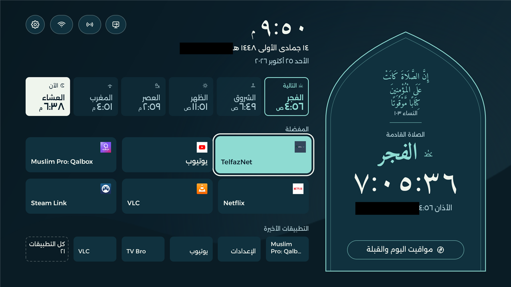
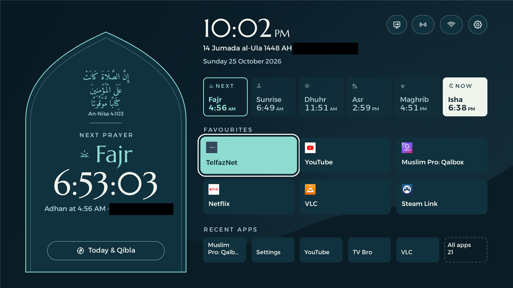
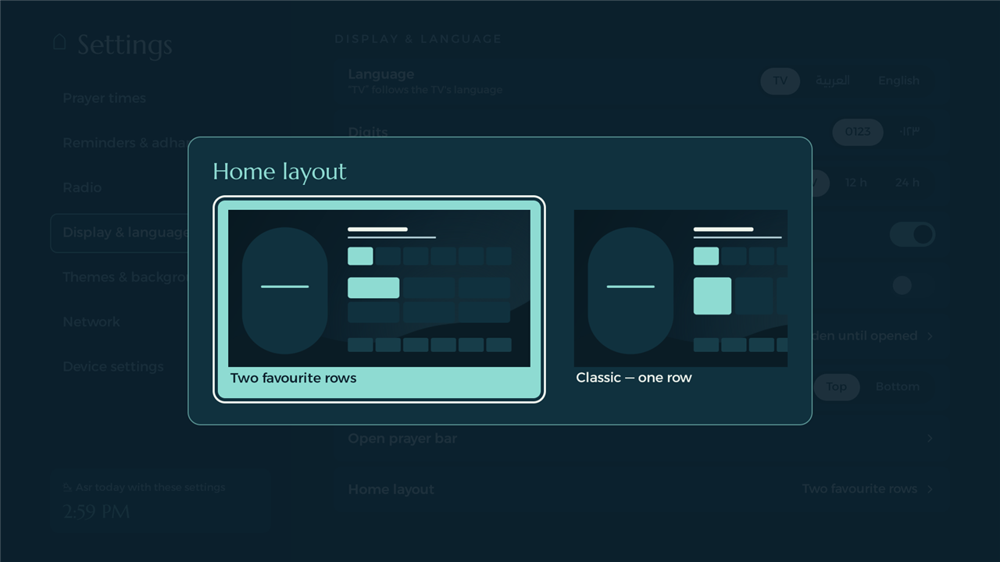
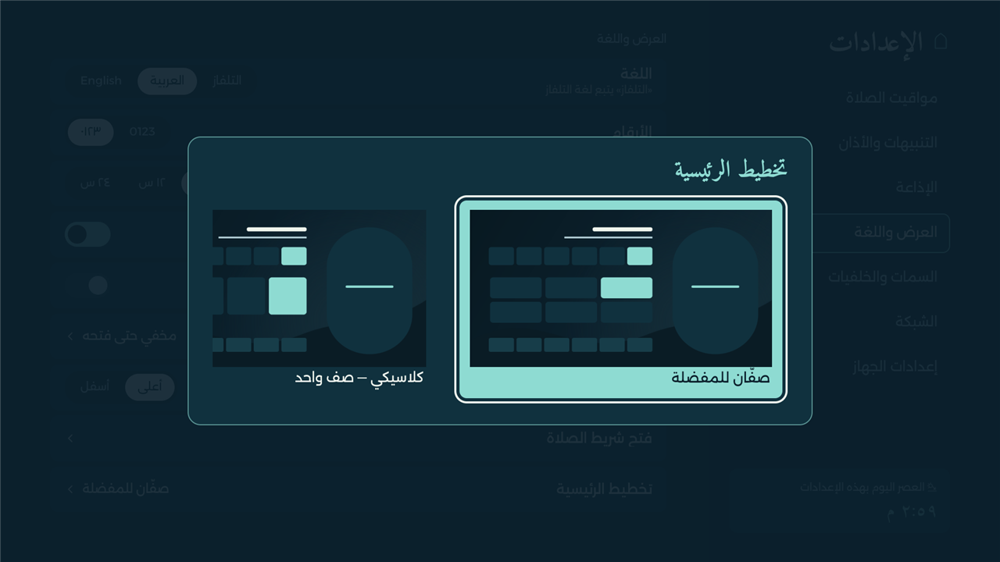
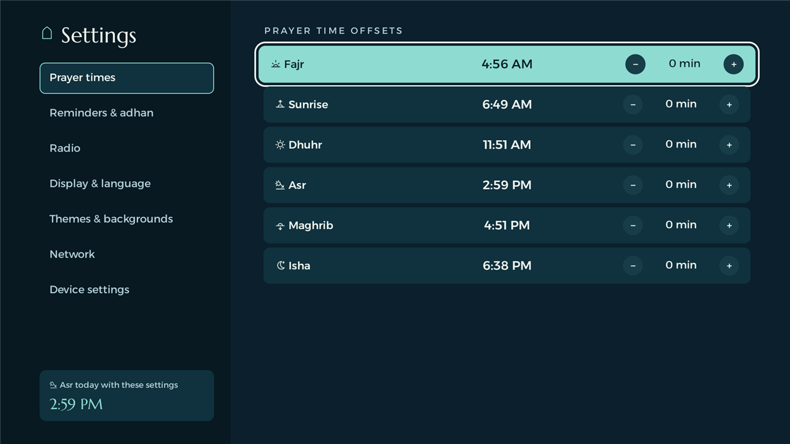
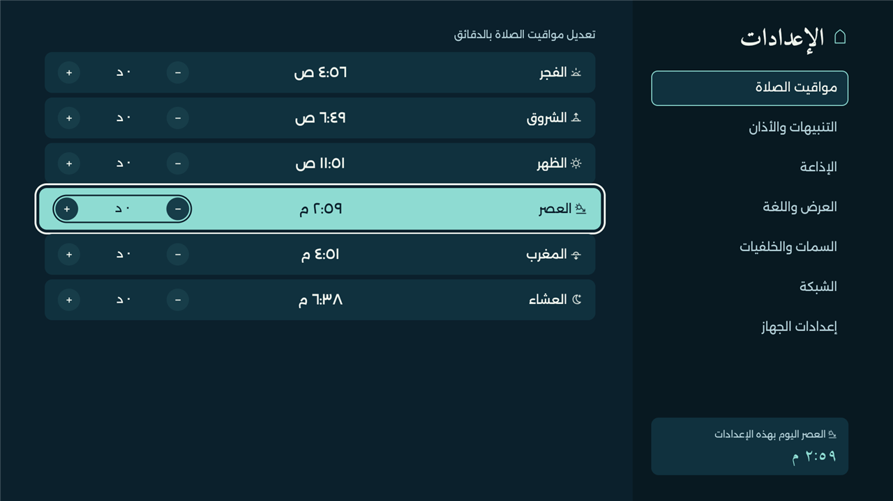
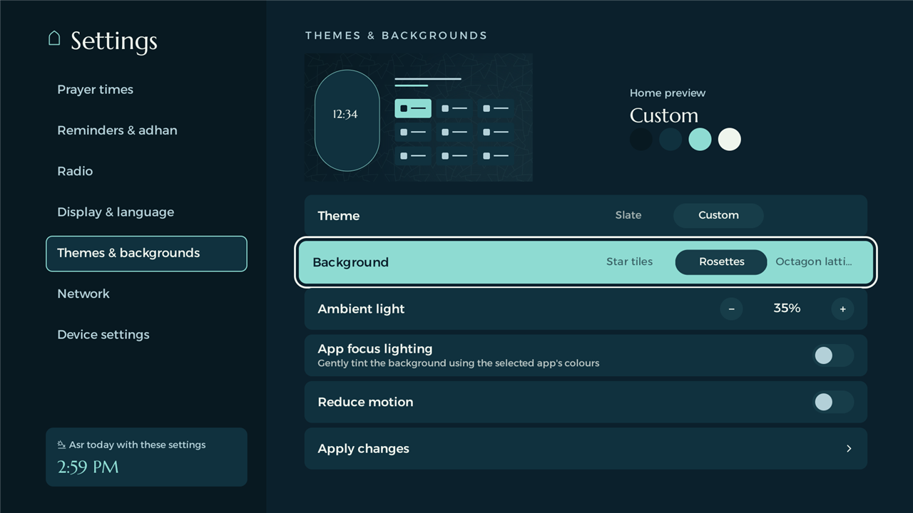
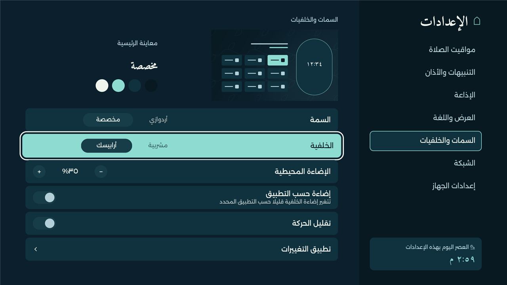
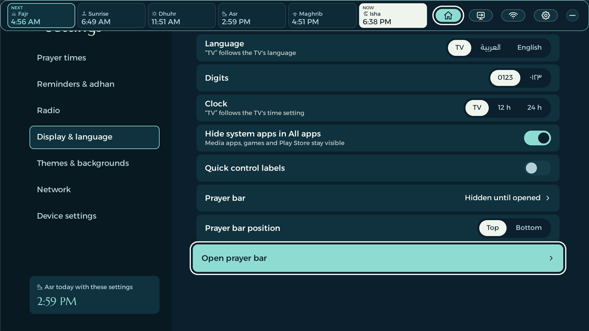
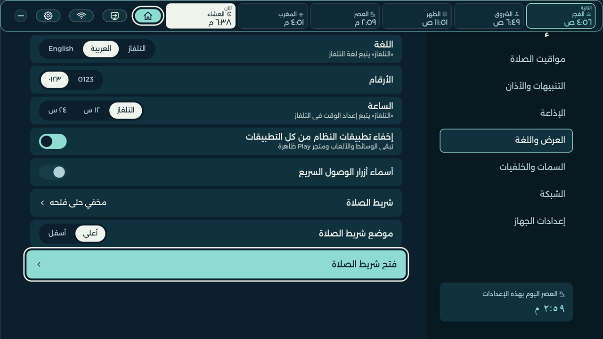

<div align="center">

# IslamicTVLauncher (Afnon) · أفنون

**An Android TV home screen built around the prayer day.**

<p dir="rtl"><b>شاشة رئيسية لتلفاز أندرويد، تجمع مواقيت الصلاة والقبلة والأذان وإذاعة القرآن الكريم.</b></p>

Arabic and English · 137 cities in 43 countries · 19 calculation methods · 14 adhan voices · 16 radio stations and reciters

[This fork](https://github.com/AbdelrahmanHajjaj/IslamicTVLauncher) · [Original Afnon](https://github.com/egyjs/afnon-android-tv-launcher) · [Build and install](#install) · [Contribution plan](docs/CONTRIBUTION-PLAN.md)



</div>

> إِنَّ الصَّلَاةَ كَانَتْ عَلَى الْمُؤْمِنِينَ كِتَابًا مَّوْقُوتًا · النساء ١٠٣
>
> *Indeed, prayer has been decreed upon the believers at fixed times.* (An-Nisa 4:103)

Afnon replaces the stock Android TV launcher with a home screen for prayer times, favourite apps and
Quran radio. Show the next-prayer countdown in a mihrab or compact bar, or hide it. Prayer reminders and the
adhan can appear over other apps; an optional compact prayer bar provides times and quick controls
without returning to Home.

This fork builds on [Afnon](https://github.com/egyjs/afnon-android-tv-launcher) and carries over
setup, recovery and lightweight background ideas from [CleanYourTV](https://github.com/Gathin23/cleanyourtv).
The TV app and its screensaver are named **IslamicTVLauncher (Afnon)**. The Android package remains
`tv.afnon.home`: updates signed with the installed app's key preserve preferences and the Home
assignment. It shares Afnon's installation identity and cannot be installed alongside it.

**Build this checkout for these features.** [Upstream APKs](https://github.com/egyjs/afnon-android-tv-launcher/releases)
and the [upstream browser demo](https://egyjs.github.io/afnon-android-tv-launcher/) do not include all
fork changes. The fork has been tested on **TCL 50C641K, Android 11**; upstream reports TCL 55P7K,
Android 12, and a Super General CVTE TV, Android 9. See the [validation record](docs/LOCAL-VALIDATION.md)
for completed checks and remaining hardware tests.

## What's included

- **Offline prayer times.** [137 cities in 43 countries](docs/CITIES.md), selected by region,
  country and city, including Leamington Spa. Choose from [19 calculation methods](docs/PRAYER-METHODS.md),
  Standard/Shafi'i or Hanafi Asr, and a Hijri date adjustment. City defaults are starting points;
  compare with your local timetable. Location discovery is not implemented. Keep the TV's timezone correct.
- **Per-prayer offsets.** Adjust each of the six times, including sunrise, from −30 to +30 minutes.
  Each card shows the adjusted time in larger, centred text beside **− / offset / +** controls.
  The preview follows the selected 12-hour (AM/PM) or 24-hour format. OK saves; Back cancels.
  Home, reminders, adhan and the screensaver use the same saved offsets. Changing city or method
  preserves offsets, so review them afterwards. Fixed offsets do not reproduce a seasonal mosque timetable.
- **Adhan and reminders.** Fourteen voices, a separate Fajr recording, per-prayer switches, advance
  reminders and optional spoken announcements. The call screen restores its temporary volume change
  afterwards. Test the banner or adhan from Settings without consuming a scheduled alert.
- **Qibla, Friday and Ramadan.** City-based Qibla bearing with a saved room direction; Jumu'ah and
  al-Kahf reminders on Friday; iftar and suhoor countdowns in Ramadan. The Hijri date uses Umm al-Qura;
  adjust it when local moon sighting differs. Six shared prayer icons accompany names throughout the UI.
- **Quran radio.** Cairo by default, with Nablus, Shabab FM, Qatar, Jordan and ten reciter channels.
  Live audio level bars, pause/resume around the adhan and screen-off listening. TCL Audio Only is used
  where supported; other TVs get a dim black-screen fallback.
- **Customizable Home.** In **Settings → Home & appearance**, choose a mihrab
  on either side (or follow the language), a compact countdown at the top/bottom, or hide the countdown.
  Independently show all prayer times, current only, next only, current and next, or hide the table.
  Current-only modes show a neutral dash when there is no current prayer. The app area reflows into the
  available space. The full-size mihrab shows the next prayer, its time, a large countdown and location,
  with the clock beside it. Preview layout, theme and background together with Left/Right, scroll through
  the choices, then **Apply changes** to save the page, or Back to cancel;
  **Reset layout to default** resets the draft. Adhan, reminders and the screensaver keep their settings.
- **Favourite rows.** Up to nine favourites across two rows, or a Classic row showing the
  first four. The Home layout preview includes both choices; switching keeps the
  complete favourites list. Without the mihrab, six favourites use four columns and two rows;
  focus rings have room around labels and neighbouring panels. Up to five recent apps and All apps remain below. Recent history records
  launches through Afnon, including assigned remote buttons, and stays on the TV.
- **App management.** Hold OK in All apps to add, reorder or replace a favourite. Replacement returns
  to Home so you can select its destination. Uninstall opens Android's confirmation for removable apps.
  An optional system-utility filter keeps media apps, games and Play Store visible. The app list caches
  metadata and creates tiles as rows enter view; its unused bottom dock and instructional footer are removed.
- **Themes and backgrounds.** Eight palettes—Mihrab, Aurora, Ember, Forest, Midnight, Rose, Sand and
  Slate—plus validated custom JSON themes. Sixteen named backgrounds and a theme-default option include
  panorama, daylight, mountains, dunes, halo, night sky and eight Islamic-inspired line patterns.
  Horizontal lists update the miniature preview immediately; **Apply changes** saves the page.
  Ambient light, reduced motion and optional app-coloured focus lighting are separate controls.
- **Quick controls.** Home has Today & Qibla, Inputs, Radio, Wi-Fi and Settings. Today & Qibla sits
  at the outer end, beyond Inputs, even when the countdown and prayer table are hidden. Inputs lists Home, registered HDMI
  sources and Live TV; **⋯ Advanced inputs** opens the TV's own source chooser. Wi-Fi opens Android's
  network panel for the current connection and available networks. A shared label switch controls Home
  and prayer-bar buttons. All apps also has a launcher Settings cog.
- **Prayer bar over other apps and inputs.** A slim, full-width row with bordered prayer cells,
  **Now** and **Next** states, Home/Inputs/Wi-Fi/Settings and a **−** minimize button. Place it at
  the top or bottom, keep it hidden until opened, show a small prayer tab, or turn it off. Assign a
  supported remote button, including a colour button, to open it. Arabic mirrors the entire bar.
- **Remote buttons and screensavers.** Assign installed apps or launcher actions to supported buttons;
  keep essential navigation, power and volume keys protected. The named launcher screensaver shows a
  dim drifting clock, date, next prayer and radio state. Alternatively select an installed custom saver
  or Google's Ambient/Backdrop when provided by the TV. Installation preserves the existing selection.
- **Guarded installation and recovery.** PC setup and the phone installer back up device state, verify
  Home takeover and record reversible disabling of supported stock launchers. Play Store, Play Services,
  input services and unrelated accessibility helpers are protected. Cleanup does not uninstall apps.

Arabic/RTL and English/LTR layouts include the new controls, with Arabic-Indic or Latin digits.
The launcher uses plain Java and Android Views with adhan-java; no AndroidX, Kotlin or Compose.
Backgrounds are small cached local drawings and eight transparent pattern masks totalling about 60 KB,
with editable [shared SVG sources](afnon-mihrab/patterns/README.md). There is no video, blur, wallpaper download or idle animation
loop. This is more functionality than CleanYourTV's minimal Home; no equivalent memory or speed claim is made.
See [themes and controls](docs/THEMES.md) for the detailed behaviour.

## Screens

Real TCL 50C641K captures from 25 October 2026, reduced for the README. Home city text is redacted;
the images are not generated mockups. [Capture notes and additional screens](docs/screenshots/README.md).

| English | العربية |
|---|---|
|  |  |
| Two favourite rows, recent apps and quick controls. | صفّان للمفضلة، والتطبيقات الأخيرة، والتحكم السريع. |
|  |  |
| Preview Two favourite rows or Classic before applying. | معاينة تخطيط الصفّين أو الصف الكلاسيكي قبل التطبيق. |
|  |  |
| Adjusted times stay centred in either language. | الأوقات بعد التعديل في وسط البطاقات في اللغتين. |
|  |  |
| Preview themes, patterns and lighting, then apply. | معاينة الألوان والزخارف والإضاءة، ثم حفظها. |
|  |  |
| Full-width prayer bar with current and next prayer. | شريط بعرض الشاشة مع تمييز الصلاة الحالية والتالية. |

## Install

Read [setup and recovery](tools/device.md) before changing the default launcher. Build this source
with **JDK 17 and Android SDK 34**. Enable debugging on the TV and approve the connection prompt.
The example address below must be replaced with your TV's address.

### From a PC

Windows:

```powershell
adb connect 192.168.1.50:5555
$env:TV = '192.168.1.50:5555'
./tools/install.ps1
python -S -B tools/device.py configure
```

Linux/macOS: set `TV`, connect with `adb`, then run `bash tools/install.sh` and
`python3 tools/device.py configure`. After verifying Home, Inputs and Settings on the physical remote,
`python3 tools/device.py home --exclusive` disables supported stock launchers reversibly. It does not
remove existing apps or automatically re-enable apps previously disabled by CleanYourTV. Keep the
recovery backup on your PC; restore only recorded changes with `tools/restore.sh` or its PowerShell twin.

### From an Android phone

Build `:installer:assembleDebug` and copy the installer APK to your phone. Choose **Install a local
Afnon APK** and select the launcher APK built from this branch. Follow Prepare and Connect, then
approve debugging on the TV. The installer performs setup over ADB; the TV APK remains the launcher.
Export the installer's private recovery record to phone storage before clearing its data.

The upstream-download option installs the original Afnon release. To install fork features, choose
the local APK. A signing-key mismatch stops the update and keeps the installed launcher; use the
same signing key for later builds. The phone installer still needs a complete real-phone test for this branch.

### Audio assets

Run `bash tools/fetch-adhans.sh` before building to download the 14 recordings for personal use.
They are Git-ignored because the source collection does not provide a redistribution licence.
Optional spoken announcements use `tools/fetch-announce.sh` and `edge-tts`; generated clips also stay
out of Git. Without them, spoken announcements are silent. Do not commit or redistribute unlicensed audio.

**Close debugging when setup and testing are finished.** Turn off USB/network debugging, revoke
authorisations, restart the TV and verify that its ADB port is closed. Port 5555 is unencrypted.

## Everyday changes

| Change | Where |
|---|---|
| City, calculation method, Asr school or Hijri date | Settings → Prayer times |
| Adjust each prayer's time | Prayer times → Prayer time offsets; compare the centred time with your local timetable |
| Choose 12/24-hour display, digits or language | Settings → Display & language |
| Customize Home and appearance | Home & appearance; Left/Right previews, Up/Down scrolls, Apply saves the page, Back cancels |
| Add, reorder or replace favourites | All apps → hold OK; replacement selects a tile on Home |
| Hide system utilities | Display & language → Hide system apps in All apps; this does not disable packages |
| Remove a removable app | All apps → hold OK → Uninstall → Android confirmation |
| Colours, patterns and app-coloured lighting | Settings → Themes & backgrounds → Apply changes; [custom JSON guide](docs/THEMES.md) |
| Show or hide quick-button labels | Display & language → Quick control labels; affects Home and the prayer bar |
| Prayer bar mode and position | Display & language → Prayer bar / Prayer bar position |
| Assign a button to an app or the prayer bar | Settings → Device settings → Remote buttons |
| Test the banner or adhan | Settings → Reminders & adhan → Test reminders & adhan |
| Choose the screensaver | Settings → Device settings → Screensaver; select IslamicTVLauncher (Afnon) or another installed saver |
| Switch input or open network settings | Home's Inputs or Wi-Fi icon; Advanced inputs opens the manufacturer's chooser |
| Re-enable a package or restore the original launcher | [Backup and recovery commands](tools/device.md) |

Home selects the first favourite when pressed again. Down moves through favourites and recent apps
to All apps; Left from the first column reaches Today & Qibla. Back minimizes the prayer bar or
closes its popup. A returning app can retain its previously selected tile when Home has not rebuilt.

Adhan opens the call screen over the current app, and Back returns to the previous activity. Individual
apps decide how they respond to audio focus. An external HDMI device has separate audio routing:
picture, sound ducking and overlay behaviour still need a live-source test. Overlays require the
prayer/button accessibility service and may be restricted by an app or firmware.

## Privacy and permissions

No accounts, ads, analytics or telemetry. Prayer calculation is offline. The TV launcher's only
network feature is the selected radio stream, listed in `Radio.STATIONS`; its
[network security config](app/src/main/res/xml/network_security.xml) permits plain HTTP only for Cairo's
stream. City, favourites, themes and recent-app history stay on the TV. The phone installer separately
uses the network for ADB setup and, when selected, downloading the upstream APK.

| Permission or service | Purpose |
|---|---|
| `INTERNET`, `WAKE_LOCK` | Radio playback, including screen-off listening |
| `RECORD_AUDIO` | Android Visualizer reads the launcher's own audio for level bars; it does not record the microphone |
| `WRITE_SECURE_SETTINGS` | Sleep-timer management, supported TCL button mappings, saver selection and optional prayer-service recovery |
| `REQUEST_DELETE_PACKAGES` | Opens Android's uninstall confirmation when explicitly requested |
| `ACCESS_FINE_LOCATION` | Retained for firmware Wi-Fi-name access; no location discovery. The current Wi-Fi control uses the system panel |
| Accessibility service | Remote shortcuts, prayer monitoring, reminders and the optional prayer bar |

The browser preview is separate: it keeps preferences in browser storage and plays a radio stream only
when requested. Its city and method data, prayer icons, patterns and text come from the native sources.
It demonstrates Home layouts, appearance and quick controls, but cannot control TV inputs, Wi-Fi,
Android overlays or screensavers. Prayer-offset editing mirrors the TV: six centred adjusted times,
minus/value/plus controls, draft cancellation and saved offsets, in Arabic and English.
[Browser offset screenshots](docs/screenshots/README.md#browser-offset-preview) show this separate preview.

## Development and contributions

Follow [CONTRIBUTING.md](CONTRIBUTING.md), including bilingual text, design tokens, physical D-pad
checks and real-TV screenshots. The [contribution plan](docs/CONTRIBUTION-PLAN.md) separates this
fork's integration work from proposed, focused upstream PRs. Fork naming is kept out of those
proposals; the original guide does not explicitly ban renaming, but upstream branding is the maintainer's decision.

```powershell
python -S -B -m unittest discover -s tests -v
./gradlew.bat --offline --no-daemon :app:assembleDebug :app:lintDebug :installer:assembleDebug :installer:lintDebug
npm.cmd --prefix site test
npm.cmd --prefix site run build
npm.cmd --prefix site run tokens:check
```

These offline Gradle commands need dependencies already cached. Use `./gradlew` and `npm` on
Linux/macOS. The preview's generator requires Node 24. See [local validation](docs/LOCAL-VALIDATION.md)
for recorded results, warning counts and untested cases; a passing build alone does not make every
feature ready for upstream.

For manual preview checks, these existing ADB hooks open temporary test states without changing the
saved city. Screenshots go to the ignored `state/` directory:

```bash
adb shell am start -n tv.afnon.home/.MainActivity --es test friday    # or ramadan; now returns to today
adb shell am start -n tv.afnon.home/.MainActivity --es test reminder  # Home reminder and optional voice
adb shell am start -n tv.afnon.home/.MainActivity --es test call      # adhan screen after 8 seconds
adb shell am start -n tv.afnon.home/.MainActivity --es test banner    # banner after 8 seconds
adb shell am start -n tv.afnon.home/.MainActivity --es test announce  # optional spoken time announcement
adb shell am start -n tv.afnon.home/.MainActivity --es test radio     # radio on/off
bash tools/shot.sh home
```

TCL firmware can handle app-button mappings before Android receives them; use named shortcuts if
button capture cannot see a press. Held volume and other vendor keys require a physical-remote test.
CVTE firmware has separate handling, and unsupported screen-off actions fall back quietly. Behaviour
observed on one board is not proof for every TV from that brand.

| Path | Contents |
|---|---|
| `app/src/main/java/tv/afnon/home/` | Home, apps, settings, prayer calculation, radio, overlays and screensaver |
| `app/src/main/assets/themes/`, `app/src/main/res/drawable/` | Theme presets, prayer icons and background patterns |
| `afnon-mihrab/tokens.json` | Shared design source; generated Java/XML/CSS must not be edited directly |
| `installer/` | Android phone installer and its private recovery/export flow |
| `tools/device.py`, `tools/setup-steps.txt` | Guarded PC setup and bundled phone setup policy |
| `tools/` | Installation, backup/restore, reversible disable/enable and optional audio downloads |
| `site/` | Local browser preview, generated data and token tools |
| `tests/`, `docs/` | Automated checks, feature guides, screenshots and validation records |

## بالعربية

<div dir="rtl">

**IslamicTVLauncher (Afnon)** نسخة مطوّرة من أفنون، تبقي الصلاة والإذاعة في قلب الشاشة الرئيسية.
اسم التطبيق وحافظة الشاشة متطابقان، ومعرّف التطبيق لم يتغيّر؛ يحتفظ التحديث بالإعدادات عند استخدام
مفتاح التوقيع نفسه. روابط إصدارات المشروع الأصلي لا تتضمّن جميع إضافات هذه النسخة.

- **١٣٧ مدينة في ٤٣ دولة و١٩ طريقة حساب**، مع اختيار مذهب العصر وتعديل التاريخ الهجري. اختيار المدينة
  يدوي، والقيم الافتراضية تحتاج إلى المقارنة مع جدول المسجد المحلي.
- **إزاحات لكل وقت** من −٣٠ إلى +٣٠ دقيقة، بما فيها الشروق. يظهر الوقت المعدّل بوضوح في وسط البطاقة،
  بتنسيق ١٢ أو ٢٤ ساعة. تبقى الإزاحات محفوظة عند تغيير المدينة أو طريقة الحساب، لذا راجعها بعدها.
- **تخطيطان للرئيسية**: صفّان للمفضلة حتى تسعة تطبيقات، أو صف كلاسيكي بأربعة تطبيقات أكبر، مع صف
  للتطبيقات الأخيرة وزر كل التطبيقات. تُعرض بطاقات معاينة قبل اختيار التخطيط.
- **ثمانية أنماط ألوان وخلفيات محلية خفيفة** تشمل المناظر والزخارف الهندسية، مع معاينة فورية وزر
  لحفظ التغييرات وإضاءة اختيارية تتبع التطبيق المحدد. العربية تعكس التخطيط واتجاه التنقل.
- **شريط صلاة رفيع** أعلى الشاشة أو أسفلها، يميّز الصلاة الحالية والتالية ويتيح الرئيسية والمدخلات
  والشبكة والإعدادات. يمكن فتحه بزر من الريموت أو إظهار لسان صغير أو إيقافه.
- **١٤ صوت أذان و١٦ محطة وقناة قرآن**، وتنبيهات متوافقة مع الألوان، وزر لتجربة التنبيه أو الأذان.
  تتوفر القبلة واتجاه الغرفة ووضعا الجمعة ورمضان وحافظة شاشة باسم التطبيق.
- **مدخلات وشبكة وأزرار ريموت**: قائمة للمنزل وHDMI والتلفاز المباشر، وإعدادات المدخلات المتقدمة،
  ولوحة شبكة النظام. يمكن إخفاء أسماء أزرار التحكم وتعيين أزرار مدعومة لتطبيقات أخرى.
- **تثبيت من الحاسوب أو هاتف أندرويد** مع نسخة استعادة وتعطيل قابل للتراجع للشاشة الأصلية.
  يبقى متجر Play وخدماته والتطبيقات الموجودة، ولا تُحذف التطبيقات أثناء التنظيف.

ابنِ التطبيق من هذا المصدر واتبع دليل التثبيت أعلاه. اختُبرت هذه النسخة على TCL 50C641K بنظام
Android 11؛ اختبار مصدر HDMI حي واختبار الهاتف الكامل ما زالا مطلوبين. أغلق تصحيح الأخطاء بعد
انتهاء الإعداد والتجارب. لا حسابات ولا إعلانات ولا تتبّع؛ حساب المواقيت لا يحتاج إلى الإنترنت.

</div>

## Credits and licence

- Original launcher, Mihrab design and project history: [egyjs/Afnon](https://github.com/egyjs/afnon-android-tv-launcher),
  originally developed with Claude Code on a real TV. This fork retains Afnon attribution.
- Setup/recovery and colour-sampling ideas: [CleanYourTV](https://github.com/Gathin23/cleanyourtv),
  Copyright (c) 2026 Gathin, MIT; [retained licence](docs/CLEANYOURTV-LICENSE.txt).
- Prayer calculation: [adhan-java](https://github.com/batoulapps/adhan-java), MIT, by Batoul Apps.
- Adhan source: [abodehq/Athan-MP3](https://github.com/abodehq/Athan-MP3); optional downloads are excluded
  from Git. Attribution alone does not grant redistribution rights.
- Radio: Cairo, Nablus, Shabab FM, Qatar, Jordan and [mp3quran.net](https://mp3quran.net), via their public
  streams. The project is not affiliated with them.
- Fonts: Amiri, Alexandria and Marcellus, SIL Open Font Licence; [third-party notices](THIRD_PARTY.md).
- Original pattern linework references are documented in [the themes guide](docs/THEMES.md#pattern-design-references);
  museum photographs are not bundled.

Code contributions use the [MIT licence](LICENSE). See [CHANGELOG.md](CHANGELOG.md) for changes.
