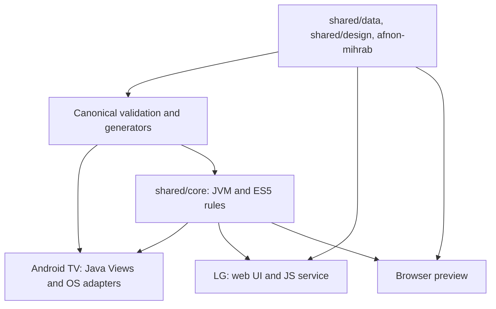

# Islamic TV Launcher architecture

One household product uses separate platform applications over a portable domain
library and canonical data/design. This describes the implemented structure.
Active migration scope, decisions and acceptance evidence live only in
[ARCHITECTURE-QUEUE.md](ARCHITECTURE-QUEUE.md).

## Module boundaries

| Module | Owns | Leaves to its consumers |
| --- | --- | --- |
| `shared/core` | Six-offset validation/normalization, prayer/reminder/comparison rules, semantic Home focus, UI control/type/range/choice and coverage checks | Astronomy, dates/timezones, clocks/timers, storage, rendering, physical key/device APIs and networking |
| `shared/data` | Stable catalog/control IDs, bilingual labels, UI control metadata, formatter literals and exact sacred text | Formatting algorithms and platform capabilities |
| `shared/design`, `afnon-mihrab` | Fonts/notices, theme/icon geometry/order, appearance IDs, tokens and SVG patterns | Native drawing, CSS layout, applying semantic focus and accessibility |
| `platforms/android-tv` | Java Views, adhan-java, Android ICU, preferences, accessibility/remote handling, scheduling, media and Home integration | Shared product rules and canonical sources |
| `platforms/webos` | ES5 renderer, adhan-js, old-LG calendar adapter, preferences, HDMI/audio handling and Activity Manager service | Shared product rules and canonical sources |
| `installer` | Existing Android-phone ADB installation, setup and recovery | TV runtime; future companion configuration/pairing |
| `site` | Browser demonstration and generated resource tools | Physical TV, device integrations and production control |

Dependencies point from shells to shared sources. The core has explicit inputs and
results and does not call back into a shell. Shared semantic input rules follow
[UI-CONTRACT.md](UI-CONTRACT.md); native renderers remain separate. No speculative
plugin/transport framework is introduced. Android remains Java Views; LG retains
its separate TV renderer. A renderer change must be checked in other affected
consumers; sharing tokens/data does not automatically update their screens.

Kotlin Multiplatform was selected after JVM/ES5 compilation, Java integration and
an actual old-LG host probe. It shares tested rules without replacing existing UI
or rewriting astronomy. The pinned build emits JVM bytecode and ES5 UMD, with fixed
filenames and the `tv.afnon:core` JS namespace. Load the Kotlin standard library
before the browser module. See [core contracts and checks](../shared/core/README.md).
The initial host proof does not certify every later integrated build on hardware.

Manual online prayer comparison keeps HTTPS/JSON/ISO validation and cancellation
in the platform adapters. `PrayerComparison` supplies canonical named-method lookup
and signed whole-minute differences. A reference never writes settings or replaces
the offline schedule; each shell binds the shared read-only `prayer.online` action.

`UiScale` validates the shared four-size policy. Each shell owns persistence and
rendering: Android scales native page content and measured overlay windows, keeps
backgrounds at viewport size, uses local themed dialog resources and bounds dream
drift by the scaled group. Display-pixel conversion remains separate from the
saved UI percentage, so service and Activity initialization cannot compound it.
External Android settings remain controlled by the OS.

## Deliberate platform differences

- Android/preview replace the displayed Fajr slot with tomorrow's after Isha. LG
  retains today's row and a separate tomorrow-Fajr value. Shared selection never
  mutates its input; sunrise is a display marker, never an alert.
- Native due-alert eligibility is `[0, 120000)` milliseconds late. LG delivery is
  inclusive `[0, 90000]`, with future-event selection and persisted handled IDs.
  Both keep clocks, claims, cancellation, OS callbacks and playback in the shell.
- Existing preferences/defaults and Hijri read/write policies stay platform-owned.
  Calendar/astronomy engines remain adapters; unavailable results do not become
  invented prayer times. LG's finite Hijri table returns unavailable outside its range.
- Android can be a system Home and use its accessibility/remote service. Old LG is
  a Developer Mode app with embedded HDMI and a demand-started JS service; it has
  no validated global remote shortcut, system Home replacement or standby wake.

## Independent builds

From the repository root, use JDK 17 and Node 24. Android additionally needs SDK 34
via `ANDROID_HOME` (or its ignored local SDK configuration).

| Target | Commands | Inputs beyond its project |
| --- | --- | --- |
| Core | `npm --prefix shared/core ci --ignore-scripts`, then `./gradlew -p shared/core check jvmJar --no-daemon` | Root Gradle wrapper/bootstrap; no SDK or shell sources |
| Android TV | `./gradlew -p platforms/android-tv verifyApkSize lintDebug --no-daemon` | Shared core/design and local optional media; no installer/preview/LG sources |
| LG | `npm --prefix platforms/webos ci`, then `npm --prefix platforms/webos test` and `npm --prefix platforms/webos run test:browser` | Shared core/data/design, tokens/patterns, common validators, wrapper and local media; no Android/installer/preview sources |
| Preview | `npm --prefix site ci`, then `npm --prefix site test` and `npm --prefix site run build` | Shared core/data/design, common generators, native projections, installer notice outputs and documentation screenshots |

On Windows use `gradlew.bat` and `npm.cmd`. Root aggregate commands retain
`:app:assembleDebug` and `:installer:assembleDebug`; the TV APK remains
`platforms/android-tv/build/outputs/apk/debug/app-debug.apk`. The native APK budget
is strictly below 25,000,000 bytes including locally bundled audio. Shared JS is
compiled once per generator invocation; avoid simultaneous preview/LG builds
writing the same generated core output.

Canonical JSON is validated by `tools/validate-shared.mjs` without shell or preview
sources. `tools/catalogs.mjs` generates native data/text/prayer vectors; token and
pattern generators live in `site/scripts/`. Edit sources, regenerate and run the
corresponding `data:check`/`tokens:check` commands. Generated Java/XML/PNG, JS bundles,
build outputs and private media are not independent sources of truth.

The 14 adhan and 12 announcement clips are local ignored inputs under
`state/media/{adhan,announce}`. Android packs its original asset names; LG requires
the clips when building its app. Neither daily runtime requires a development PC.
Recordings, keys, captures, backups, device addresses and logs stay outside Git.

## Identity, ownership and acceptance

Keep the installed IDs `tv.afnon.home`, `tv.afnon.webos` and
`tv.afnon.webos.service`, existing data directories/settings keys and signing keys.
Upgrade over the installed app; uninstalling to make an update pass can destroy
preferences. No storage reset or settings-key migration is part of this refactor.

This project is independently maintained in
[AbdelrahmanHajjaj/IslamicTVLauncher](https://github.com/AbdelrahmanHajjaj/IslamicTVLauncher).
The original [Afnon](https://github.com/egyjs/afnon-android-tv-launcher) MIT copyright,
[CleanYourTV credit](CLEANYOURTV-LICENSE.txt) and [third-party notices](../THIRD_PARTY.md)
remain. Repository history is retained; publishing, merging and GitHub detachment
are separate owner operations. Preview build/support and optional installer downloads
target this project. A stable TV release asset must exist before the online installer
can download it; source/local APK installation remains available.

Full project/CleanYourTV MIT texts are generated from their retained canonical
sources into shared and installer assets. Both APKs, LG app/service and preview
carry them. Android TV also bundles adhan-java's pinned MIT text; installer assets
carry its existing ADB, SPAKE2, Conscrypt and native-component notices/source
references. See `THIRD_PARTY.md` and the packaged `licenses/SOURCES.txt`. No runtime
dependency or licence is changed by collecting these notices.

Automated builds, JVM/Node/service checks and browser mocks are separate evidence
from physical picture, sound, remote, power and upgrade tests. The queue records
which current integration checks remain open. Modern LG/Samsung/other Sony support
is not claimed without validation; Sony Android/Google TV uses the Android shell.
Companion Android/iOS apps, LAN pairing/control, accounts/cloud and remote updates
are deferred. TVs that cannot support later pairing need not support it to use the
standalone launcher.
