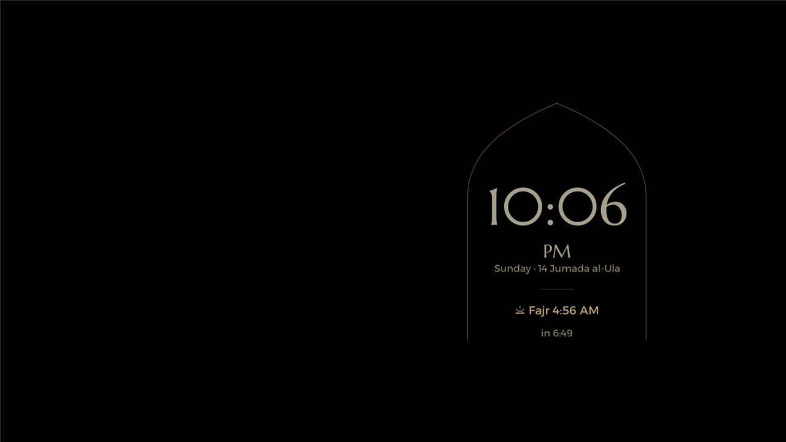
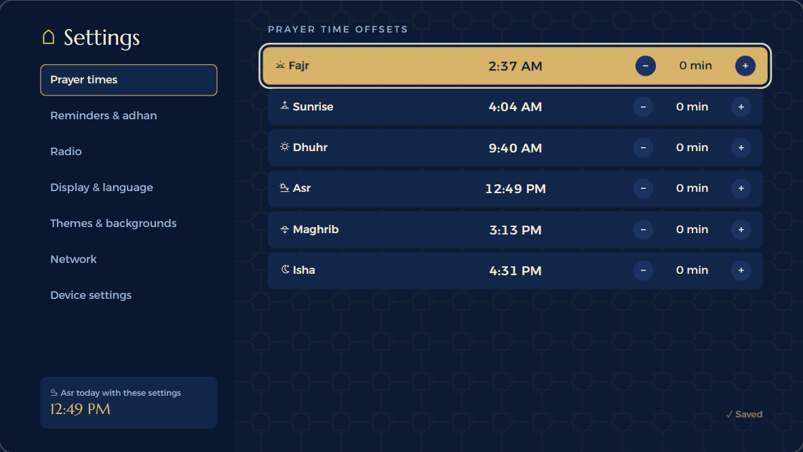
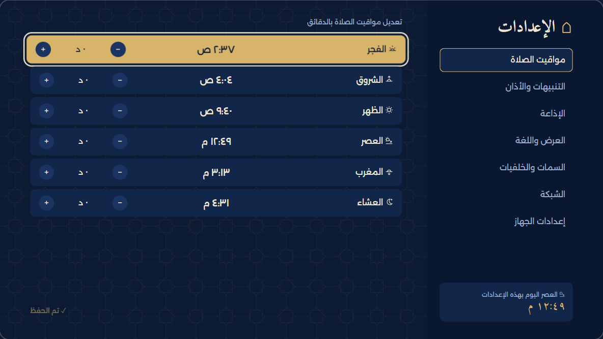

# Screenshot notes

The images below are native TV captures from **TCL 50C641K, Android 11**, taken on **25 October 2026**
during the fork's feature checks. They are resized to 1280×720 for documentation. They are not browser
renders or AI-generated images. Home's city text is covered with opaque rectangles in both languages;
the underlying unredacted captures remain private. No room orientation, network settings, account
details or device identifiers are included in these refreshed images.

| Feature | English | Arabic |
|---|---|---|
| Home, two favourite rows | [Home](home-en.png) | [الرئيسية](home-ar.png) |
| Home layout selector | [Layout cards](layouts-en.png) | [اختيار التخطيط](layouts-ar.png) |
| Prayer offsets | [Adjusted times](offsets-en.png) | [إزاحات المواقيت](offsets-ar.png) |
| Appearance preview | [Themes and Rosettes](appearance-en.png) | [الألوان والخلفيات](appearance-ar.png) |
| Expanded prayer bar | [Prayer bar](prayer-bar-en.png) | [شريط الصلاة](prayer-bar-ar.png) |
| All apps | [App grid](all-apps.png) | [كل التطبيقات](all-apps-ar.png) |

Installed apps and prayer times in these images are examples from the test device, not default
favourites or a published prayer timetable. Appearance screenshots show preview states; they do not
imply that every preview was saved. The bar is shown over launcher Settings, not a live HDMI source.

## Screensaver

The installed Android dream service was selected and started for this capture. Its picker label is
**IslamicTVLauncher (Afnon)**. Automatic start after idle and physical Home wake passed separately on 26 October 2026; see the [validation record](../LOCAL-VALIDATION.md).

## Earlier upstream examples

These unchanged captures predate the fork UI additions and remain as upstream feature examples and
preview-site social images. Do not use them as evidence of the current fork layout:

- [Today's prayers and Qibla](prayer-day.png)
- [Radio](radio.png)
- [Adhan](call.png)
- [Reminder](reminder.png)
- [Friday](friday.png)
- [Ramadan](ramadan.png)
- [Settings](settings-en.png)
- [Radio settings](settings-radio.png)

## Browser offset preview

These two captures are from the local browser preview on **26 October 2026**, not from the TV.
They use the preview's default city and zero offsets, with no imported personal TV settings.
They show centred adjusted times and the same six minus/value/plus controls in both languages.

| English | Arabic |
|---|---|
|  |  |

## Home customization PR (26 October 2026)

The following unedited captures show the current customization branch. Settings and All apps are native captures from TCL 50C641K / Android 11. Home images are explicitly **browser previews**, using the default demonstration city and zero offsets; their times follow the browser environment and are not a city timetable. Native Settings and All apps captures contain no network name, account details, location or device identifier. Installed app names are examples from the test TV.

| Screen | English | Arabic |
|---|---|---|
| Home — browser preview | [Home](custom-home-browser-en.png) | [الرئيسية](custom-home-browser-ar.png) |
| Settings — native TV | [Settings](custom-settings-en.png) | [الإعدادات](custom-settings-ar.png) |
| All apps — native TV | [App grid](custom-apps-en.png) | [كل التطبيقات](custom-apps-ar.png) |
